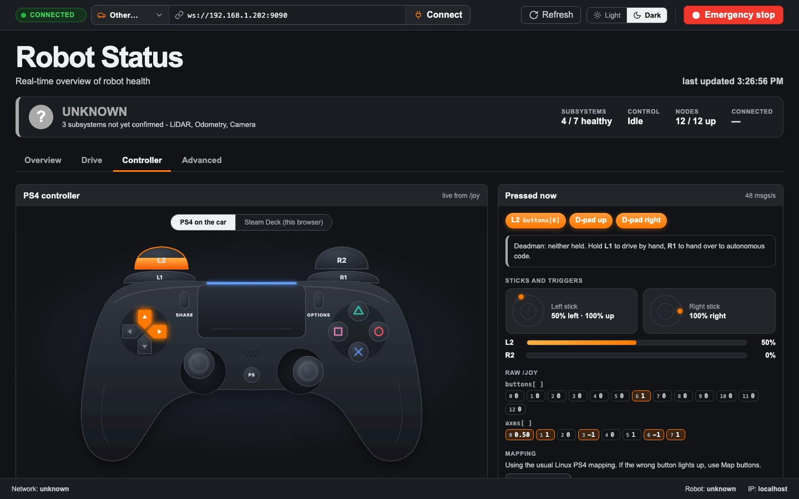
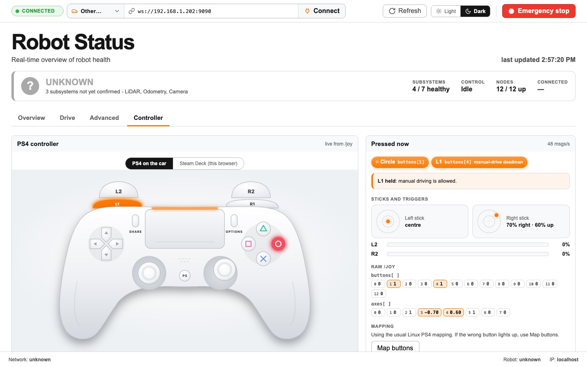
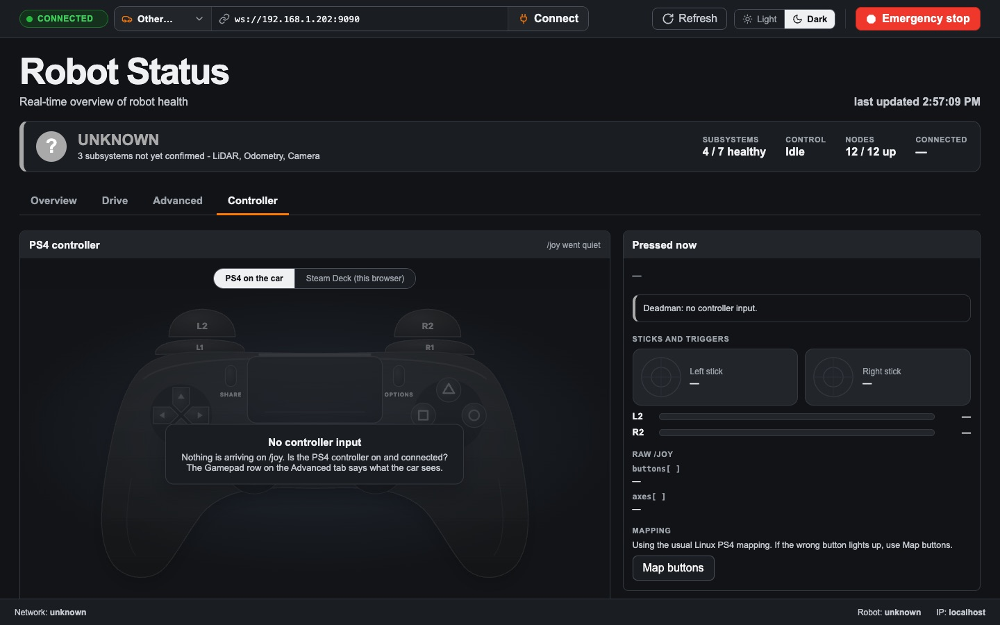
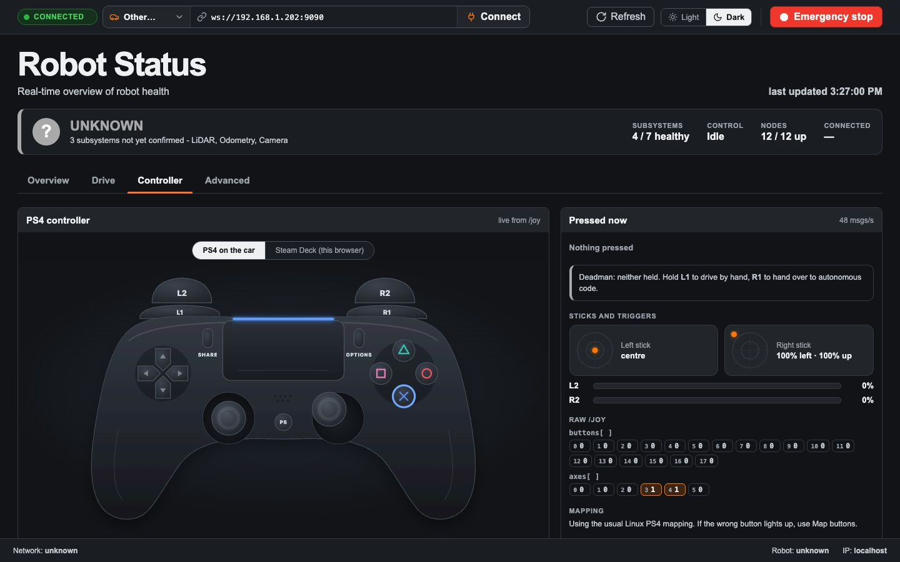
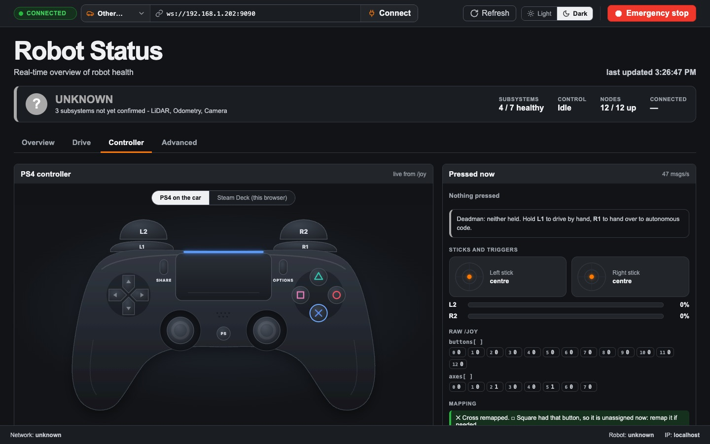
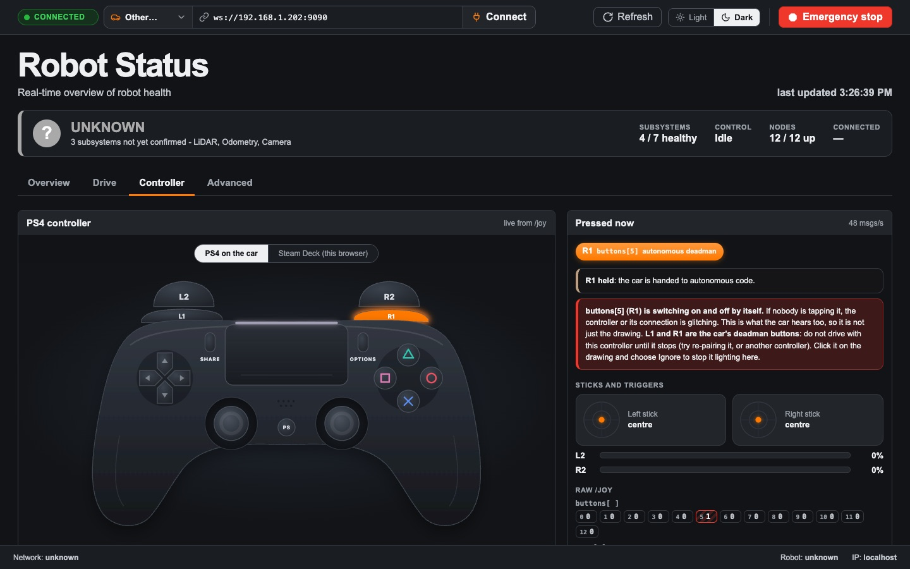
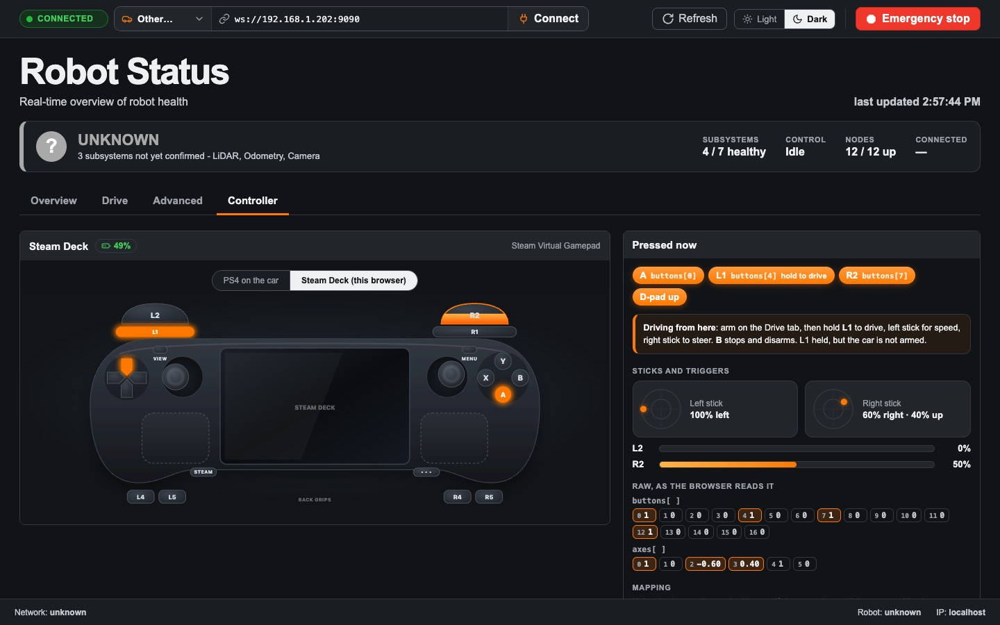
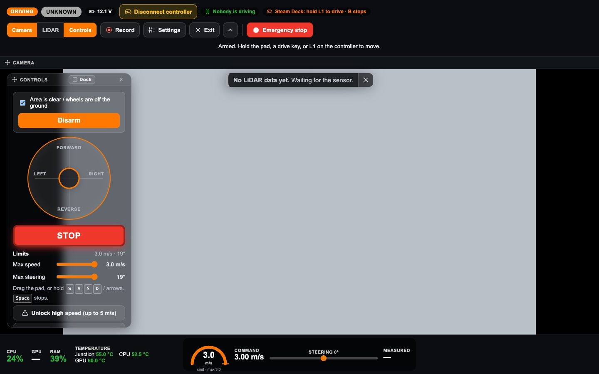

# The Controller tab: a user guide

How to see, live, what the car hears from the PS4 controller: which buttons are pressed, where the sticks and triggers are, and whether the deadman buttons work. The same tab shows a **Steam Deck**, and lets you drive the car with it from the dashboard in its browser.

This guide is for **anyone checking a controller**: before driving, when a button "does nothing", or when setting up a car. Driving itself is in [drive-tab.md](drive-tab.md).

*The screenshots are from the real dashboard with a simulated controller.*

## What it shows

The drawing is the car's view of the controller, live from `/joy`, the topic the controller driver publishes about 48 times a second:

- **Buttons light up orange** while they are held: the four face buttons, L1 and R1, Share, Options, PS, the touchpad, and each stick when pressed in (L3, R3).
- **The D-pad** lights the direction pressed.
- **L2 and R2 fill up** from the bottom as you squeeze them, so you can see a half press.
- **The sticks move** with yours.
- **The light bar** glows blue while the controller is talking to the car, and turns **orange while L1 or R1 is held**, the deadman buttons the car watches.

Buttons press in a little and glow: the four face buttons in their own colours (teal triangle, red circle, blue cross, pink square), everything else orange. In light mode the controller is drawn white.

While the tab is open, the page takes `/joy` at its full rate; on the other tabs it reads it five times a second, which is all they need.

Beside the drawing, each stick is a small map with a dot where it is pushed, each trigger a bar, and:

| Part | What it shows |
|---|---|
| **Pressed now** | Every control held right now, in words, with its index in `buttons[]` |
| **Deadman** | Whether **L1** (drive by hand) or **R1** (hand over to autonomous code) is held. These are the two buttons the car itself watches. With **Hold R1 to run** on in the Drive tab, holding R1 also drives the page's autonomous run ([Drive guide](drive-tab.md#hold-r1-to-run)) |
| **Sticks and triggers** | Each stick's direction and how far (*50% left · 100% up*), and how far each trigger is in |
| **Raw /joy** | Every number in the message, a chip per index; the ones not at rest are lit. This is what your own code sees |
| **msgs/s** | How many `/joy` messages arrive each second. About 48 means the controller is connected and talking |

## When nothing shows

If nothing arrives on `/joy` for a second, the drawing greys out under **No controller input**. A connected controller publishes even when nobody touches it, so this means the car is not hearing it. Check, in order:

1. **Is the controller on and paired?** Its light bar should be solid, not flashing.
2. **The Gamepad row** on the Advanced tab's Robot System says what the car sees: connected, no Bluetooth link, or connected but unreadable.
3. **Run joystick check** on the Advanced tab tells "no controller" apart from "ROS cannot open it".

## Map buttons

Which number is which button depends on the driver the car uses. The tab starts with the numbering the cars' `/joy` uses (measured on F1-WSU-2): the Jetson's kernel has no Sony driver, so the controller is read as a generic gamepad. Square, Cross, Circle, Triangle are `buttons[0]` to `[3]`, L1 and R1 are `[4]` and `[5]` (as `joy_teleop.yaml` expects), L2 and R2 are `[6]` and `[7]` and also `axes[3]` and `[4]`, Share, Options, L3, R3, PS and the touchpad are `[8]` to `[13]`; the right stick is `axes[2]` (left and right, the axis the car steers from) and `axes[5]` (up and down). A laptop with a newer kernel numbers the same controller differently. If the wrong button lights up when you press one, map it: If the wrong button lights up when you press one, map it:

1. Press **Map buttons**.
2. Do what it asks: press each button, squeeze each trigger, push each stick left and then up, press the D-pad up and left (and down and right if your D-pad is buttons). The one it wants pulses blue on the drawing.
3. Hold each one for a moment, then let go. It takes a press only once it has lasted 0.15 s, and moves on when that control is back where it was. A brief glitch is never taken as the answer.
4. **Skip** anything your controller does not have (the touchpad click, for one). Skipped controls keep the usual numbering.

The mapping is saved in this browser; **Use the default** goes back to the usual one.

The tab also notices when the numbering is probably wrong. A real trigger rests at +1 on its axis; if L2's or R2's axis has not been seen there after a few seconds, the tab says so, with a nudge to **Map buttons** (with the wrong numbering, a stick resting slightly off centre reads as a trigger partly squeezed).

### Remap just one

If only one control is wrong, there is no need to map them all again:

1. **Click it on the drawing**, or pick it in **Remap one** and press **Remap**. A stick's movement is in the list as *Left stick (move)* and *Right stick (move)*.
2. Press and hold the control you want for it.

Only that one changes; the rest of your mapping stays. If the button you pressed belonged to another control, that other one is unassigned (it says which), so two controls never light for one button.

**Ignore it** instead of pressing: the control is no longer read at all, so it stops lighting. Use it for a button that misbehaves. Remap it later to bring it back.

### A button switching on and off by itself

If a button turns on and off rapidly with nobody touching it, the tab says so in red and stripes it in **Raw /joy**. That is the controller or its Bluetooth connection glitching, and the important part is that **the car hears it too**: the drawing shows exactly what `/joy` sends. If it is **L1 or R1**, the car's deadman buttons, do not drive with that controller until it stops. Try switching it off and on, re-pairing it, charging it, or another controller.

**Map buttons** never takes a flickering button as an answer: if the one it is asking for is flickering, it says so and waits until it has been steady for a couple of seconds. **Ignore it** stops it lighting on the drawing, but it cannot stop the car from hearing it.

### The deadman warning

![A mapping where L1 is not buttons[4]](images/controller-tab/04-deadman-mismatch.jpg)

If your mapping puts L1 or R1 anywhere other than `buttons[4]` and `buttons[5]`, the deadman box turns red. The car's `joy_teleop.yaml` reads those two indexes, so on this controller **holding L1 would not let you drive, and the emergency stop's "is someone holding the deadman?" check would be wrong too**. Fix it in `joy_teleop.yaml` on the car, or use a controller that reports the usual numbering.

## Steam Deck: drive from its browser

Switch the tab to **Steam Deck (this browser)** to see the controller of the device the dashboard is open on. On a Steam Deck that is the Deck itself; any controller plugged into a laptop shows up here too. It reads the controls through the browser, not through the car, so it works the same on any car. The Deck's own battery shows beside the title, where the browser reports it (Chrome does; Firefox does not).

### Driving with it

The Deck drives the car with its sticks:

| Control | Does |
|---|---|
| **Left stick**, up and down | Speed, forward and reverse. Pushing a stick is the deadman, like the on-screen pad: centre both and the car stops |
| **Right stick**, left and right | Steering |
| **L1**, held | Also drives with the sticks, the way the car's own controller does. This is what works on a controller the browser does not map as "standard", read through this tab's mapping |
| **R1**, held | Starts an autonomous run when **Hold R1 to run** is on ([Drive guide](drive-tab.md#hold-r1-to-run)) |
| **B** | Stop and disarm |

While armed, the drive note and the Controls card say which gamepad the page sees, or why the sticks are off (*No gamepad detected - press a button on it*, or *not mapped as standard*). The on-screen knob follows the sticks.

You still **arm on the Drive tab** first (tick the safety box, press Arm), and every rule the page has still applies: centring the sticks stops the car at once, leaving the tab or the window disarms, and the physical PS4 controller still overrides. The speed and steering limits are the Drive tab's. A small dead zone means a stick resting a little off centre does not creep the car.

The driving view shows **Steam Deck: sticks drive · B stops** in its top bar while a controller is connected.

### Setting up the Deck

A browser sees the Deck's controls only when Steam gives them to it as a controller. On the Deck's desktop they move the mouse instead.

1. In **Desktop Mode**, install a browser (Chrome works best; it also shows the battery).
2. In Steam, **Add a Non-Steam Game** and pick the browser. Open its **Properties**, and in **Launch options** add the dashboard's address, for example `http://192.168.1.202:8000/dashboard.html`.
3. In the browser's **Controller settings**, pick a **gamepad** layout (Gamepad with Joystick Trackpad, or the Web Browser template's gamepad option), not keyboard and mouse.
4. Launch it from **Game Mode**. Press any button once: browsers only show a controller after a button has been pressed on the page.

The back grips (L4, L5, R4, R5) have no standard place, so they show only if Steam's layout sends them as buttons; **Map buttons** learns where they went. The trackpads are drawn but not read: a browser does not get them as a controller.

## For code

Your own nodes read the same `sensor_msgs/Joy` on `/joy`. The **Raw /joy** chips give you the index of every button and axis without guessing. Axes follow ROS's convention: **left and up are positive**, and a trigger rests at **+1** and reads **-1** squeezed all the way (it reads 0 until it is first touched).
