# The Drive tab: a user guide

How to drive a RoboRacer from the dashboard: what is on the screen, how to arm and drive, what stops the car, how to arrange the view, and how it works on a phone.

This guide is for **people driving the car**. How the commands reach the motors, and where each piece lives in the code, is in the dashboard README, [Driving from the page](../../README.md#driving-from-the-page). The emergency stop has its own entry, [Emergency stop](../../README.md#emergency-stop). The other tabs have their own guides: [Overview](overview-tab.md) and [Advanced](advanced-tab.md).

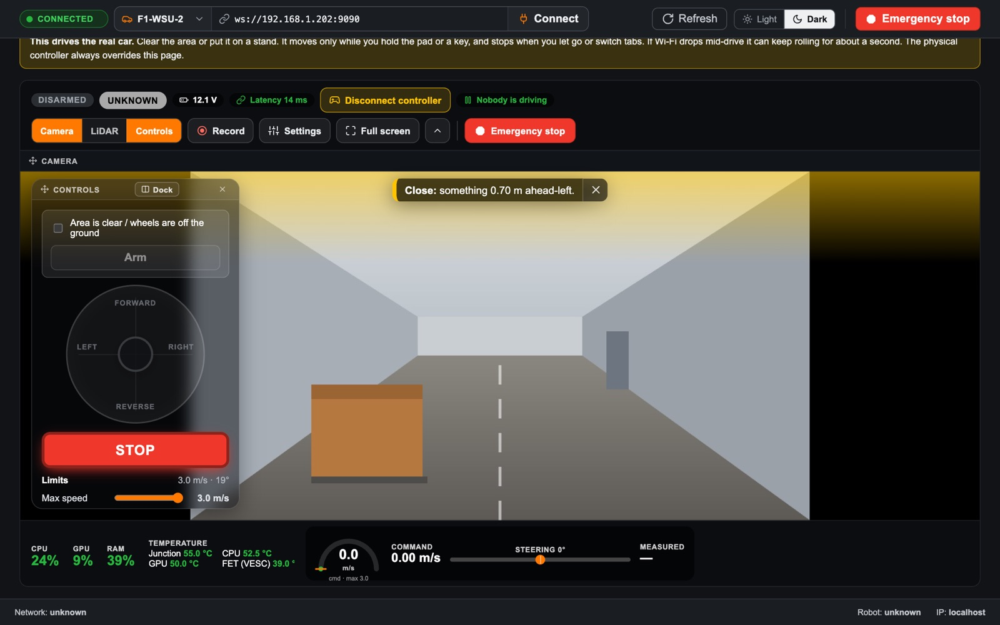

*The screenshots in this guide are from the real dashboard with a simulated robot. The camera picture is a stand-in; on a car it is the car's own camera.*

## Contents

1. [Before you drive](#before-you-drive)
2. [A tour of the screen](#a-tour-of-the-screen)
3. [Driving, step by step](#driving-step-by-step)
4. [What stops the car](#what-stops-the-car)
5. [Full screen](#full-screen)
6. [Seeing what is around the car](#seeing-what-is-around-the-car)
7. [Arranging the view](#arranging-the-view)
8. [Recording the camera](#recording-the-camera)
9. [Autonomous run](#autonomous-run)
10. [Speed and steering limits](#speed-and-steering-limits)
11. [On a phone](#on-a-phone)
12. [Keyboard](#keyboard)
13. [Troubleshooting](#troubleshooting)
14. [How a command reaches the car](#how-a-command-reaches-the-car)

## Before you drive

The yellow box at the top of the tab says it plainly: **this drives the real car.**

- **Clear the area, or put the car on a stand** with its wheels off the ground.
- **Have someone hold the physical controller.** It is your backup stop, and it always wins over the dashboard (see [Who is in charge](#who-is-in-charge)).
- **Check the top bar says CONNECTED** and the right car is picked (for example `F1-WSU-2`).
- **Check the battery.** The top bar of the driving view shows the voltage; the Overview tab grades it.
- **Know where Emergency stop is**: the red button at the far right of every bar. It stops the car for everyone.

## A tour of the screen

The Drive tab *is* the driving view, embedded in the page. **Full screen** makes the same view cover the whole screen; everything below works the same in both.

### The top bar

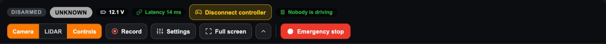

Status on the left, actions on the right, Emergency stop last and set apart so it is always in the same corner.

| Item | What it tells you or does |
|---|---|
| **DISARMED / ARMED / DRIVING** | The state of the controls on this page. DRIVING means a command is going out right now |
| **Health pill** | The overall verdict from the Overview tab (HEALTHY, DEGRADED, FAILED, UNKNOWN) |
| **Battery** | The battery voltage from the motor controller (VESC) |
| **Latency** | The round trip from this page to the car and back, every 2 s. Green under 50 ms, amber from 50 ms, red from 120 ms. Each command takes about half of it to arrive (see [Why the controller feels quicker](#why-the-controller-feels-quicker)) |
| **Disconnect controller** | Shown while a physical controller is connected. Drops its Bluetooth link; press the PS button on the controller to reconnect. Refused while someone holds L1 or R1 |
| **Who is driving** | One answer: *Nobody is driving*, *You're armed*, *You are driving*, *The controller is driving*, *Someone else is driving*, *Autonomous code is driving*, or *Emergency stop is on* |
| **AUTONOMOUS DRIVING** / **Autonomous standby** | Shown only while autonomous code is up: red and pulsing while it is driving the car, amber while it is running but not sending commands. Holding L1 on the controller overrides it; Emergency stop stops it. It is in the side rail too |
| **Camera · LiDAR · Controls** | Which panes show. Orange means on |
| **Record** | Records the camera to a video file; press again to stop and save it (see [Recording the camera](#recording-the-camera)) |
| **Settings** | Everything about how the view looks (see [Arranging the view](#arranging-the-view)) |
| **Full screen** / **Exit** | Cover the whole screen, or come back. Leaving full screen disarms |
| **⌃** | Hide the top bar for more picture. On a computer the essentials move to a [side rail](#hiding-the-top-bar-the-side-rail) |
| **Emergency stop** | Stops the car for everyone (see [What stops the car](#what-stops-the-car)) |

A row of messages can appear under the bar: red alerts that must not be missed (*Not connected*, *No data from the robot*, *Emergency stop is on*) and short notes about what just happened (*Armed. Hold the pad or a drive key to move.*).

### The picture and the controls

The camera fills the view. The **Controls** card floats over it as see-through glass, bottom left by default: drag its title bar to move it anywhere, **Dock** to make it a column beside the pictures, **×** to close it.

### The bottom bar

The robot's computer on the left (CPU, GPU, RAM and temperatures, coloured by how they grade), and the speed readout in the middle:

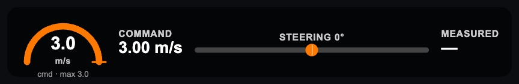

- **The speedometer arc** is the car's measured speed (from `/odom`), or your command until the car reports one. The **orange tick** is what you are commanding. The scale ends at your max-speed limit, so a full arc means "at the limit". The arc turns orange near the limit and blue in reverse.
- **Command**: the speed being sent. **Measured**: what the car reports.
- **Steering**: the angle being sent, with a marker that slides left and right.

Speed can be shown in m/s, km/h or mph (Settings → Readouts).

## Driving, step by step

### 1. Arm

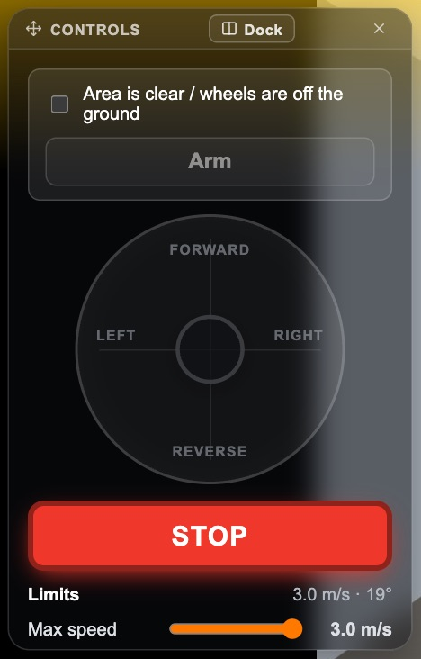

Tick **Area is clear / wheels are off the ground**, then press **Arm**. Arm stays greyed out until the box is ticked, the page is connected, nobody else is driving from another dashboard, and the emergency stop is off.

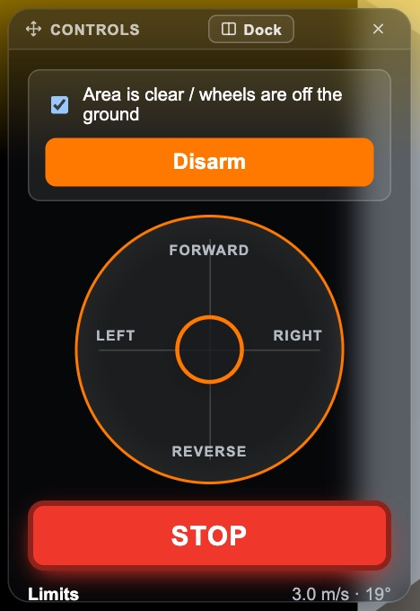

Armed, the button turns orange and reads **Disarm**, the pad lights up orange, and the top bar shows **ARMED** and *You're armed*. Nothing moves yet.

### 2. Drive

Pick whichever is easiest; they all do the same thing.

- **The pad**: press and drag the knob. Up is forward, down is reverse, left and right steer. How far you drag sets how fast and how hard.
- **The keyboard**: hold **W A S D** or the **arrow keys**.
- **On a phone**: the two thumb sticks (see [On a phone](#on-a-phone)).
- **On a Steam Deck** (or a controller plugged into your computer): the left stick is speed and the right stick steers; pushing a stick is the deadman, so centring them stops the car. **B** stops and disarms. Holding **L1** with the sticks works too, and is what drives a controller the browser does not map as standard. Setting it up is in [the Controller guide](controller-tab.md#steam-deck-drive-from-its-browser).

**The car only moves while you hold.** Let go and it stops at once: the page sends a burst of zero-speed commands immediately, without ramping down.

The page sends **50 commands a second** while you hold, about the physical controller's own rate, and a press or a release goes out at once rather than waiting for the next one. The **keys** are all or nothing, so their speed builds up: about **0.4 s from stop to the normal top speed of 3 m/s**, with steering at full lock in about 40 ms. The **pad** and the **thumb sticks** are proportional like the controller's stick, so they follow your thumb almost at once (3 m/s in 0.15 s). Stopping is never ramped.

### 3. Stop and disarm

Press **STOP**, or **Space**. Both stop the car and disarm. To drive again, press Arm.

## What stops the car

The page stops and disarms by itself whenever it can no longer be sure you are in control:

| What happens | What the page does |
|---|---|
| You let go of the pad, the sticks or the keys | Stops (stays armed) |
| **STOP**, **Space**, or **Esc** on the Drive tab | Stops and disarms |
| You untick the safety box | Disarms |
| You switch to another tab, or leave full screen | Disarms |
| The browser window loses focus, the page is hidden, or it closes | Disarms |
| The connection to the robot drops or is replaced | Disarms |
| The emergency stop comes on | Disarms, and Arm stays greyed out until it is released |
| You open an unlock dialog, arrange the thumb sticks, or reset the view settings | Disarms |
| On a phone: you close the controls, or turn the phone upright | Disarms (the sticks go with them) |

**If Wi-Fi drops mid-drive**, no stop command can reach the car. The robot catches that itself: when `/drive` goes quiet for **0.3 s** while the car was moving, `system_diagnostics.py` on the robot sends zero speed. The car can still roll for a moment, which is why the yellow box warns about it.

### Emergency stop

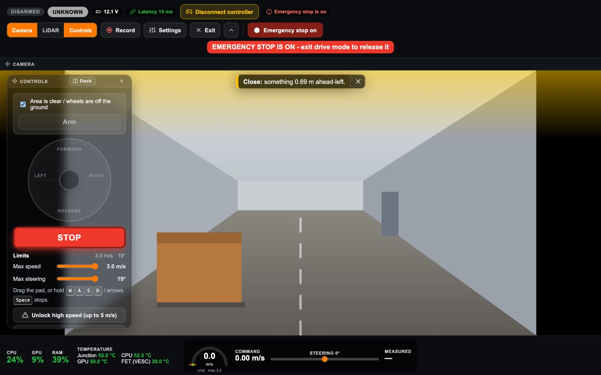

**Emergency stop** stops the car **for everyone**: this page, other dashboards, the physical controller and any autonomous code. On the robot it freezes the node that turns drive commands into motor commands, and holds the motor at zero.

While it is on, the button turns dark red and reads **Emergency stop on**, a red alert stays in view, and nobody can arm. To release it, leave full screen and press **Allow driving again** on the red banner under the page's top bar. It asks first, and it is refused while someone holds a deadman on the controller.

The full story is in the README's [Emergency stop](../../README.md#emergency-stop).

### Who is in charge

The physical controller always wins. If someone holds its deadman (L1 or R1), the car follows the controller and ignores this page. *Who is driving* then reads **The controller is driving**. If another dashboard or autonomous code is sending commands, this page refuses to arm.

## Full screen

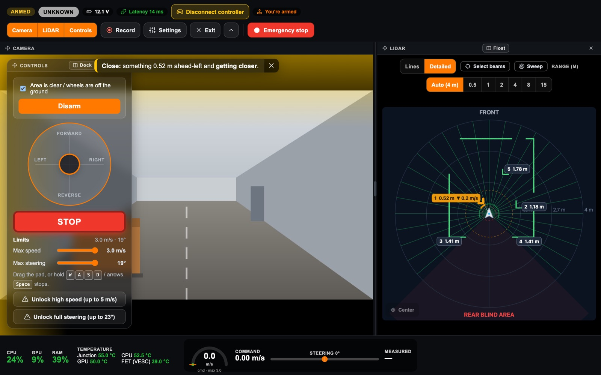

**Full screen** turns the same view into a first-person driving screen. Camera and LiDAR can sit side by side; drag the divider between them to change the split. To move a pane, drag it by its title: over the **left half** of another pane it goes before it, over the **right half** after it, and that half lights up orange to show where it will land. **Esc** cancels the move (and, as always on the Drive tab, stops the car). **Exit** (or **Esc**) comes back, and disarms.

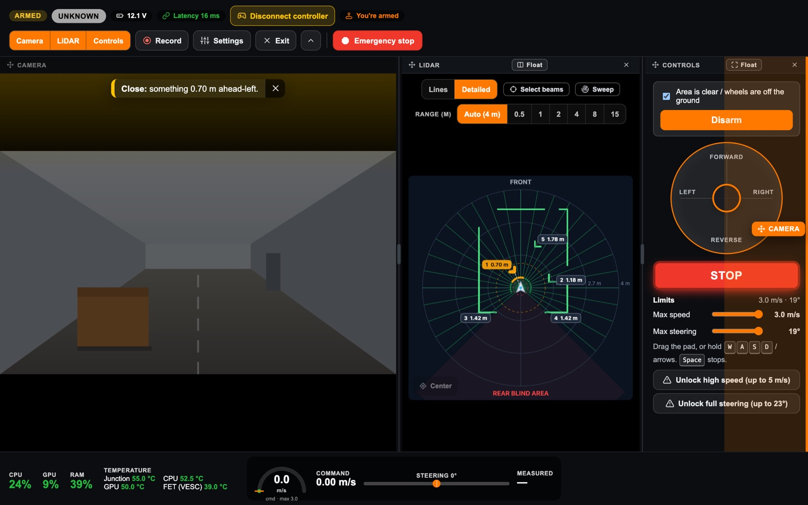

The Overview tab's camera buttons open full screen directly, with just the camera or the camera and LiDAR.

## Seeing what is around the car

### The LiDAR pane

The LiDAR is a top-down map with the car in the middle, facing up. In the **Detailed** view (as in the picture above) it is a radar:

- Every LiDAR return is a small green dot, and walls are drawn as connected outlines.
- The five nearest objects get a **numbered tag** with their distance. Anything closer than 1 m is outlined in amber, closer than 0.3 m in red.
- Something getting closer shows **▼ and its speed** on its tag.
- A dashed line runs to the nearest thing, dashed circles mark 0.3 m and 1 m, and a ring around the car is coloured by each direction's status.
- **Point at the map** for details: an object's distance, direction, width and whether it is approaching; or, over empty space, how far and in which direction that spot is.

**Lines** is the simpler view: one green outline of everything the LiDAR sees. Zoom with the range buttons or the scroll wheel, drag to look around, and press **Center** to bring the car back to the middle.

In the Detailed view, **Sweep** in the LiDAR's toolbar turns the radar's turning line on or off (also in Settings → LiDAR). The **×** at the right of the LiDAR's title closes it, like the Controls card's; **LiDAR** in the top bar (or the rail) brings it back. If the LiDAR is the only picture, the camera takes its place.

### LiDAR over the camera

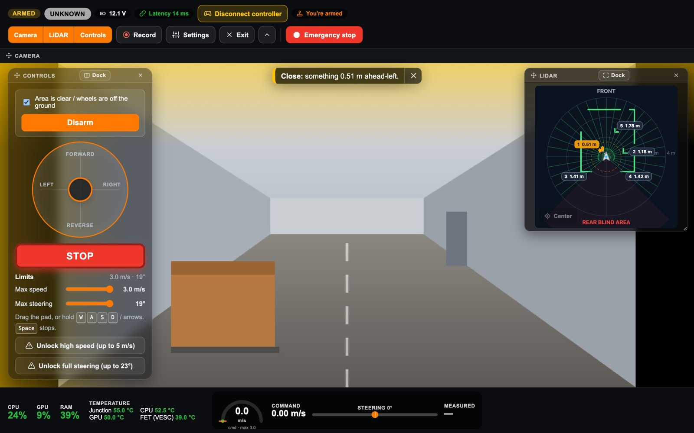

**Float** on the LiDAR pane's title turns it into a small window over the camera. Drag its title to move it, drag its corner to resize it, and press **Dock** to put it back beside the camera.

### Warnings on the picture

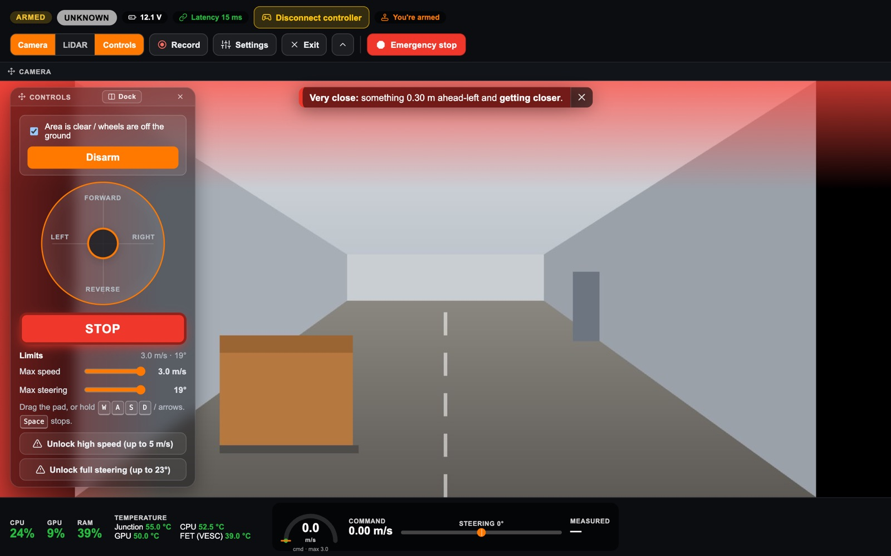

- **Edge warning lights.** The edge of the picture facing an obstacle glows **amber within 1 m** and **pulses red within 0.5 m**, like a car's parking sensors: the top edge for ahead, the sides for left and right.
- **The close-object warning.** A sentence on the picture: *Close: something 0.70 m ahead-left*, or *Very close: … and getting closer*. Drag it anywhere. **×** hides it; Settings → *Close-object warning* brings it back.
- **On a phone**, it also buzzes once the moment something comes within 0.5 m while you are armed (if the phone supports it).

## Arranging the view

### Settings

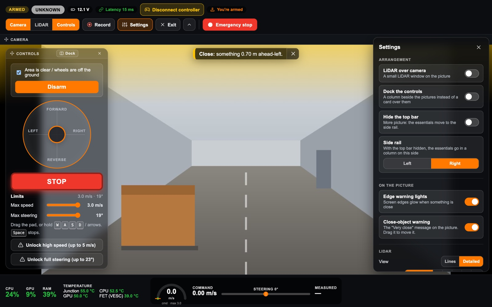

**Settings** holds everything about how the view looks. It closes with **×**, a click anywhere else, or **Esc**. All of it is remembered in your browser.

| Section | Options |
|---|---|
| **Arrangement** | LiDAR over camera · Dock the controls · Hide the top bar · Side rail on the left or right · *Controls only* (phones) |
| **On the picture** | Edge warning lights · Close-object warning |
| **LiDAR** | Lines or Detailed · range · Sweep line (the turning line on the Detailed view) |
| **Readouts** | Speed in m/s, km/h or mph |
| **Screen** | Keep the screen awake · Buzz when very close (phones) |
| **Keyboard** | The keys, as a reminder (desktop) |
| **Thumb sticks** | Move sticks & STOP (phones) |
| **Camera** | Reconnect camera |
| | **Reset all view settings**: every layout, position and switch back to its default |

### Docked controls

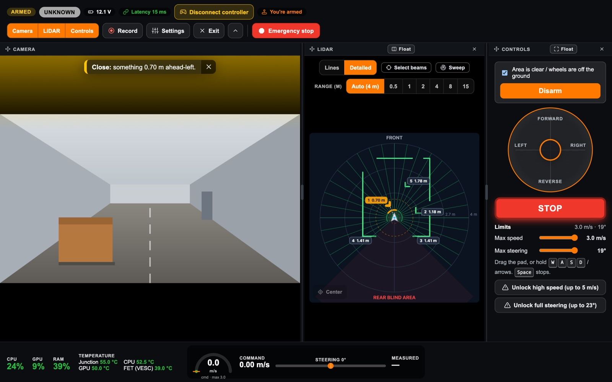

If you would rather the controls never cover the picture, **Dock** them (on the card's title, or in Settings). They become a column beside the camera and LiDAR, with a divider you can drag. **Float** turns them back into a card.

### Driving with the controls closed

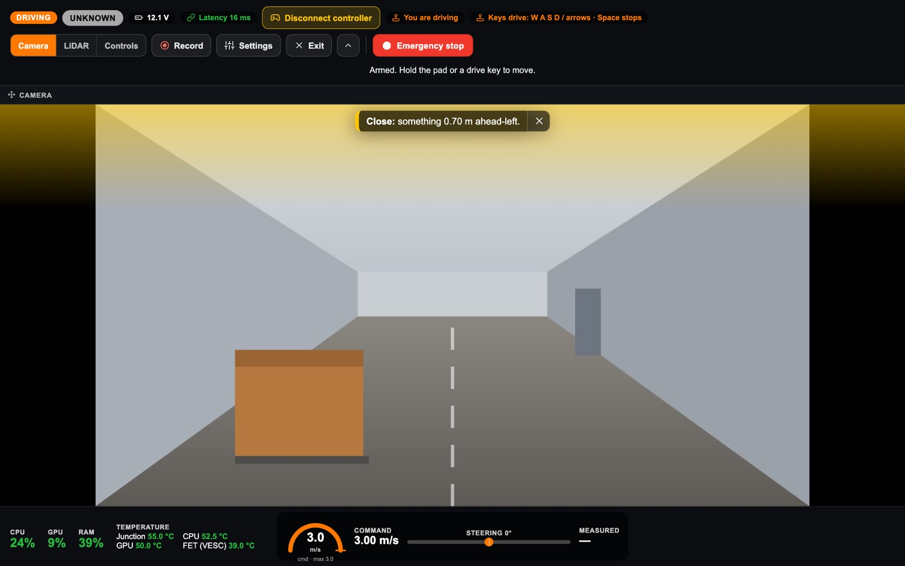

On a computer, closing the Controls card (its **×**, or **Controls** in the top bar) **does not disarm**. The keys still drive, and an orange chip in the top bar says so: *Keys drive: W A S D / arrows · Space stops*. This gives you the whole picture while you drive.

### Hiding the top bar: the side rail

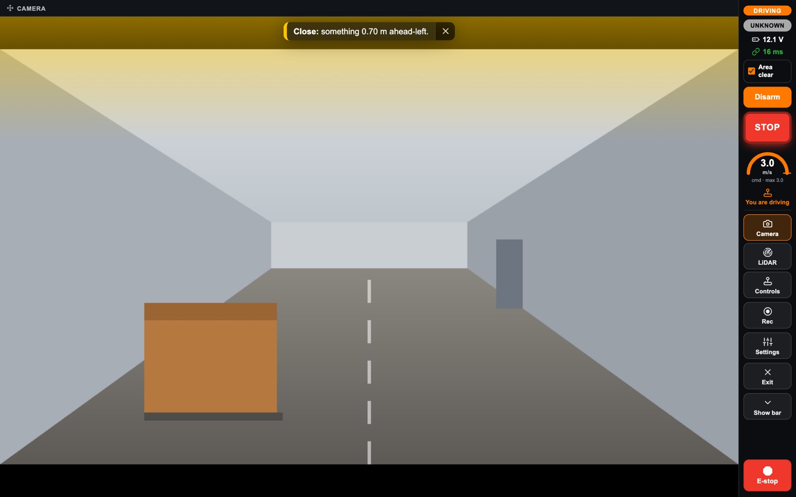

**⌃** in the top bar (or Settings → *Hide the top bar*) tucks the top and bottom bars away, so the picture gets the whole height. On a computer, on the Drive tab and in full screen, everything you need to drive moves into a narrow **side rail**. Top to bottom:

- the **state** (DISARMED, ARMED, DRIVING), the car's health and the battery
- **Area clear** and **Arm** / **Disarm**, and **STOP**
- the **speedometer** and who is driving
- **Camera**, **LiDAR** and **Controls**, **Rec**, **Settings**, **Full screen** (or **Exit** in full screen) and **Show bar**
- **E-stop**, at the bottom

Red alerts and notes still show over the top of the picture. On a short screen the rail's buttons keep only their icons. It goes on the right; Settings → **Side rail** → **Left** moves it. **Show bar** brings the bars back.

On a phone, hiding the bar keeps a small cluster in the corner instead: the **ARMED** state, **Disarm**, **E-stop**, any red alert, and **Show**.

## Recording the camera

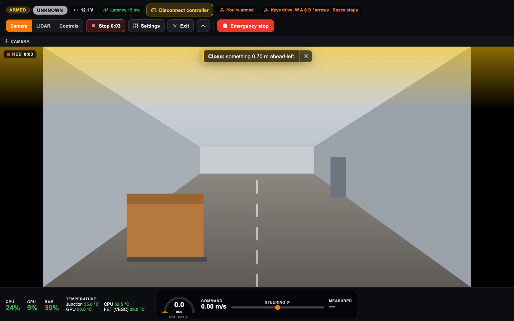

**Record** (in the top bar, the rail, or under the camera on the Overview) records what the camera shows. While it runs, the button turns red with the time, and **● REC** shows on the picture. It carries on if you switch tabs or go full screen.

Press it again to stop: the video downloads straight away, named by when it started, for example `camera-2026-10-26-14-03-22.mp4` (`.webm` in browsers that cannot make MP4). The recording happens in your browser from the picture already on screen, so it adds nothing to the car's Wi-Fi. A recording stops by itself after 15 minutes, because it is held in the browser's memory until it is saved. The page asks before closing while a recording runs.

## Autonomous run

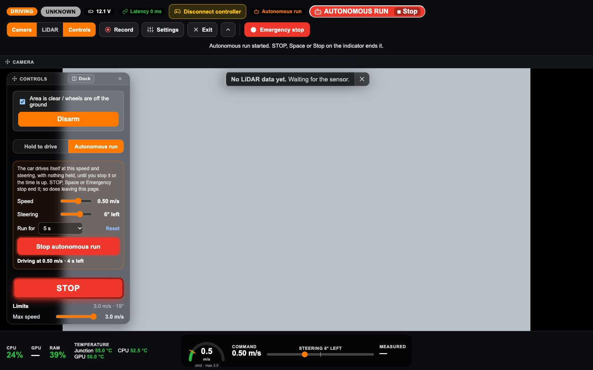

The car can drive itself at a set speed and steering, with nothing held: what

```bash
ros2 topic pub /drive ackermann_msgs/msg/AckermannDriveStamped "{drive: {speed: 0.2, steering_angle: 0}}" -r 10
```

does on the car, but from the page.

1. In the Controls card, switch **Hold to drive** to **Autonomous run**.
2. **Full speed** (on by default) drives forward at your **Max speed**, the same top speed as full stick with L1 held. Turn it off to set **Speed** with the slider (forward or, below zero, reverse). Set **Steering** too. Both are limited by Max speed and Max steering, and both can be changed **while it runs**. Full speed is remembered in this browser.
3. Pick **Run for**: 5 s, 10 s, 30 s, 1 min, or until stopped.
4. Tick the safety box and press **Start autonomous run**. It arms by itself if the box is ticked.

It starts gently, like the keys. The pad, the keys or a controller held still take over while they are held.

**With a controller connected to the car, a run needs R1 held.** While the car's controller is connected, its teleop node sends zero speed with every controller message, and the car's command mux puts the controller ahead of `/drive`, so the car only takes a run's commands while R1 (the autonomous deadman) is held. The panel shows this: **Hold R1 to run** is switched on and cannot be turned off while the controller is connected, and says why. Unplug or turn off the controller and the switch is yours again. A run started with nothing held ends, with that reason, if a controller connects during it.

### Hold R1 to run

Turn on **Hold R1 to run** and R1 on the controller becomes the run's deadman, the way L1 is for driving by hand:

- **Hold R1 for half a second** and the car drives at the panel's speed and steering. A quick tap does nothing.
- **Let go** and the car stops at once. The page stays armed, so holding R1 again runs again.
- It works with the car's PS4 controller (read through `/joy`, which runs at full rate while this is on) and with a Steam Deck's R1.
- The safety box must be ticked. A hold arms the controls by itself if they are not armed.
- R1 uses the Controller tab's mapping. An R1 that has flickered on and off by itself in the last 2 s cannot start a run, and the panel says so.
- If `/joy` goes quiet while R1 is held, the car stops, as if R1 were let go.
- The switch is off again after a reload (and on, locked, whenever a controller is connected to the car). It works only in the Autonomous run mode, and only on the Drive tab.

Run for does not apply here: the hold is the limit.

### Obstacle stop

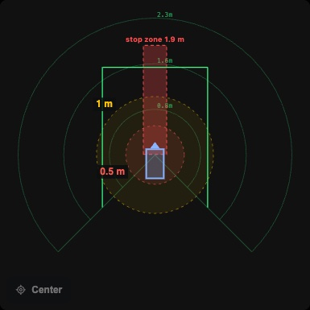

The car watches its LiDAR straight ahead whenever something drives it forward through `/drive`: an autonomous run from this page, a `ros2 topic pub`, or your own node. If anything in the strip in front of the car (0.4 m wide) is closer than the car needs to stop, **the car turns the emergency stop on by itself**.

- **How far it needs:** the **Keep clear** margin (0.3 m by default), plus 0.15 s of travel before the stop takes hold, plus braking at 4 m/s². That's 0.58 m at 1 m/s, 1.1 m at 2 m/s and 1.9 m at 3 m/s.
- **The stop zone** is drawn on the LiDAR views in the Autonomous run mode, at the run's speed: orange, or **red when something is already in it**.
- **When it trips**, the banner reads **Obstacle stop** and says what it saw, for example *something 0.62 m ahead at 2.00 m/s*. The run ends, and a `ros2 topic pub` on the car is stopped too. Clear the way, let go of L1 and R1, and press **Allow driving again**.
- **No LiDAR, no driving:** if the scan stops coming for half a second while the car is driving forward, that trips it too, because the car can no longer see ahead.
- **It does not watch** driving by hand: the controller (L1) and the page's **Hold to drive** are yours to steer. It doesn't watch reverse either, because the LiDAR can't see behind the car.
- The **Obstacle stop** switch and **Keep clear** are settings on the car, shared by every dashboard. They are back to on and 0.3 m when the car's stack restarts. With an older `system_diagnostics.py` on the car, the switch is greyed out. Every kill switch below still works while R1 is held, and after one, R1 must be let go before a new hold can start it.

**Stopping it, the kill switch:** **STOP**, **Space**, **Esc**, **Stop autonomous run**, the **■ Stop** on the indicator, or **Emergency stop**. It also ends by itself when the time is up, and on everything else that disarms: leaving the tab or full screen, the window losing focus, the connection dropping. That is the point of running it from the page instead of from a terminal on the car: if the page or its Wi-Fi goes, the car's drive watchdog stops the car within 0.3 s, where a `ros2 topic pub` left running on the car would keep it driving.

While it runs, the top bar shows **AUTONOMOUS RUN ■ Stop**, *who is driving* says **Autonomous run**, and the status banner's **Autonomous** reads **Driving**.

### Stopping autonomous code on the car

When something else drives the car through `/drive` (a `ros2 topic pub` in a terminal, or your own node), the **Autonomous** indicator says **Driving** or **Standby**, with a **Stop** beside it (and on the driving view's chip). Stop asks the car to kill the `ros2 topic pub` (its process number is in its ROS node name, `_ros2cli_<pid>`) and then sends zero speed, so the car stops at once. Your own node it names but does not kill: it cannot know what else that process does, so stop it where it runs, or use **Emergency stop**, which stops everything.

## Speed and steering limits

The Limits section of the Controls card is always in view.

- **Max speed** and **Max steering** sliders cap what the pad, keys and sticks can ask for. The normal limits are **3 m/s and 19°**, the same as the stock controller.
- **Unlock high speed (up to 5 m/s)** and **Unlock full steering (up to 23°)** raise the caps. Each opens a warning that spells out the risk and needs two boxes ticked:

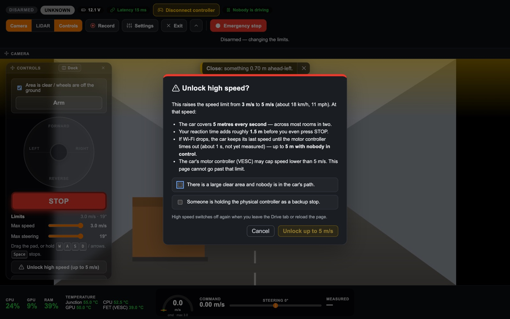

Opening a warning disarms. An unlock lasts until you leave the Drive tab or reload the page; it never carries over. The motor controller (VESC) may cap speed or steering lower than these, and the page cannot go past that.

## On a phone

Driving with thumbs needs the whole screen and the phone held sideways, so on a phone the Drive tab shows the pictures, and **Controls** takes you to full screen to drive.

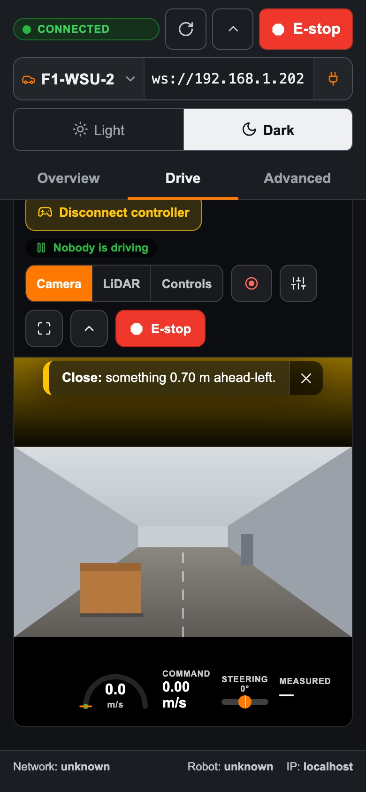

Held upright, full screen asks you to turn the phone:

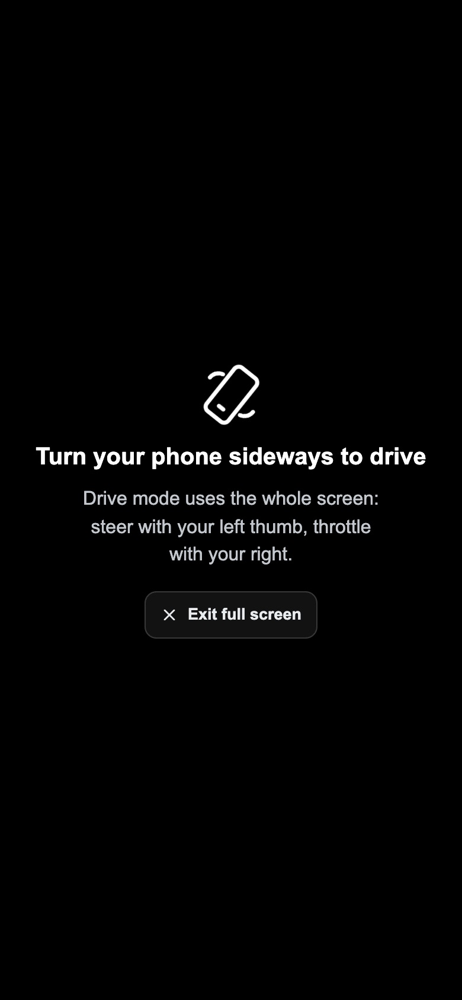

Sideways, it is laid out like a game:

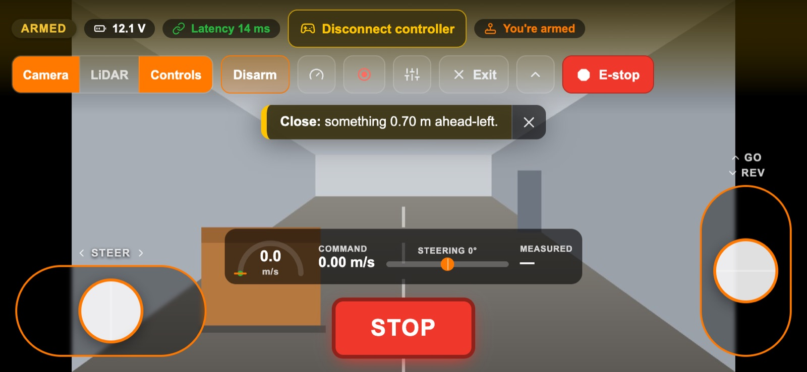

- **Left thumb steers** (drag left or right). **Right thumb is the throttle** (up to go, down to reverse). Use both at once.
- **STOP** is in the middle. **E-stop** is in the top bar.
- **Arm** is in the top bar. The **gauge** button opens the safety box and the limits:

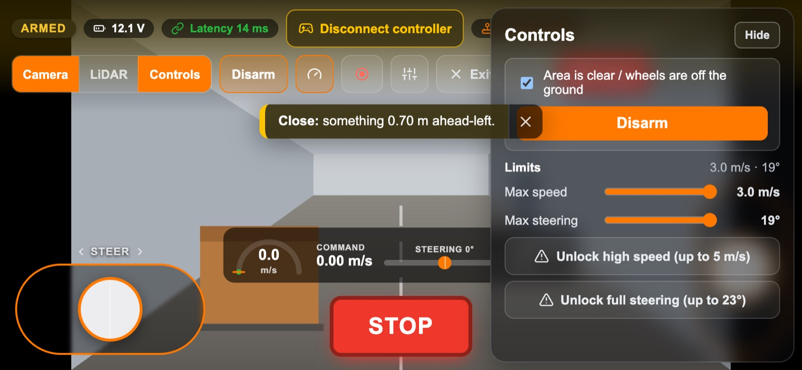

- The **sliders** button opens Settings. **⌃** hides the top bar.
- **Controls only** (Settings) hides everything but the sticks and STOP; the corner keeps ARMED, Disarm, E-stop and Show:

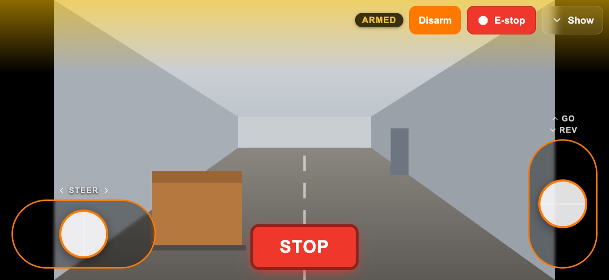

- **Move sticks & STOP** (Settings → Thumb sticks) lets you drag them to where your thumbs reach. Driving is off while you arrange; **Done** finishes, **Reset** puts them back:

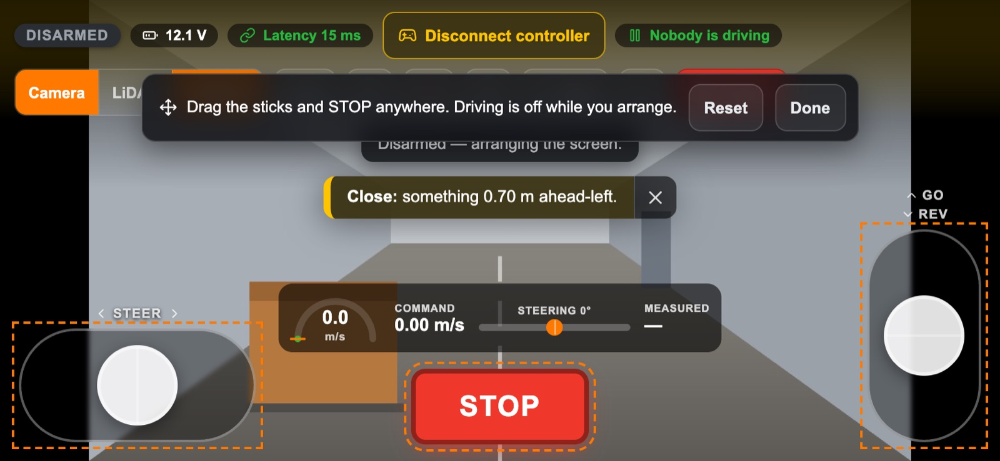

The phone keeps its screen awake while the view is open, so it does not lock mid-drive. On iPhones a web page cannot go truly full screen or lock the rotation, so the view fills the browser window instead.

## Keyboard

| Key | What it does |
|---|---|
| **W A S D** or **arrows** | Drive, while armed and held |
| **Space** | Stop and disarm |
| **Esc** | On the Drive tab: stop and disarm. In full screen: close Settings, or finish arranging, or leave full screen |

The keys drive even with the Controls card closed. They do nothing while you are typing in a box.

## Troubleshooting

**Arm stays greyed out.** Check, in order: the safety box is ticked; the top bar says CONNECTED; *Who is driving* does not say someone else is driving; the emergency stop is off.

**I am armed but the car does not move.** You have to hold the pad, a key or a stick: arming alone sends nothing. If *Who is driving* reads *The controller is driving*, someone is holding the controller's deadman and it overrides this page. If the speedometer shows a command but *Measured* stays at zero, the commands are not reaching the motor: see the README's [Troubleshooting](../../README.md#troubleshooting).

**It disarmed by itself.** The note under the top bar says why (*window lost focus*, *connection lost or replaced*, *left the Drive tab*, …). See [What stops the car](#what-stops-the-car).

**The camera is black or behind.** The camera connects on its own when the robot does. **Reconnect camera** (Settings → Camera) retries. On a weak Wi-Fi link the picture drops frames rather than falling behind; if it is choppy, move closer to the router.

**The controls are in the way.** Drag the card by its title, Dock it, or close it and drive with the keys.

**The view looks wrong after rearranging.** Settings → **Reset all view settings**.

### Why the controller feels quicker

The physical controller talks to the car over Bluetooth, and its commands never leave the car: from the stick to the motor command takes about 20 ms, measured, every time. A command from this page has a longer way to go: your computer's Wi-Fi, the router, the car's Wi-Fi, then rosbridge, which unpacks it before it joins the same path as the controller's. That trip is usually 5 to 30 ms, but Wi-Fi is shared and bursty, and when a packet is lost the ones behind it wait for the resend, so now and then a command arrives 100 ms or more late. That is the hitch you feel.

The page now does what it can on its own side: 50 commands a second (it was 20), a key or a touch goes out at once (it waited up to 50 ms), and the pad and sticks follow your thumb with no ramp to speak of. The rest is the link, and the **Latency** reading in the top bar (and the side rail) shows it. When it is amber or red:

- **Move closer to the router**, or use one on 5 GHz.
- **Turn the camera off** while driving (the **Camera** button). Its picture is about 10 to 15 Mbit/s on the same Wi-Fi as your commands.
- **Close other dashboards** on the same car; each one adds its own traffic.
- **Drive with the pad or the sticks** for fine control. The keys are on or off, so they ramp.

**Nothing is Responding, All Nodes are down.** Likely Cause: Faulty Battery **Replace Battery**

## How a command reaches the car

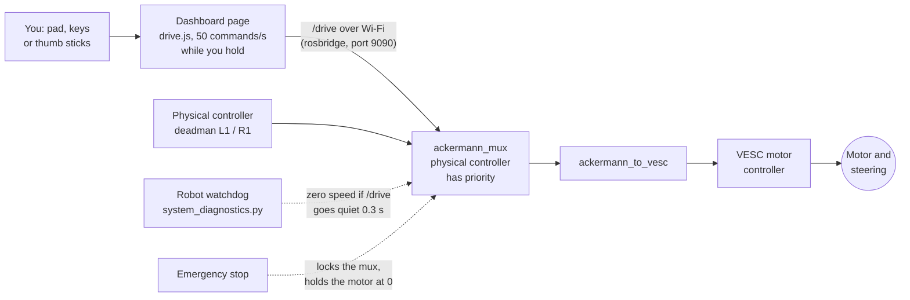

The page publishes `ackermann_msgs/AckermannDriveStamped` on `/drive`, the mux's navigation input, over the same rosbridge connection the rest of the dashboard uses. The details, every safety rule and where to change each setting are in the README's [Driving from the page](../../README.md#driving-from-the-page).
